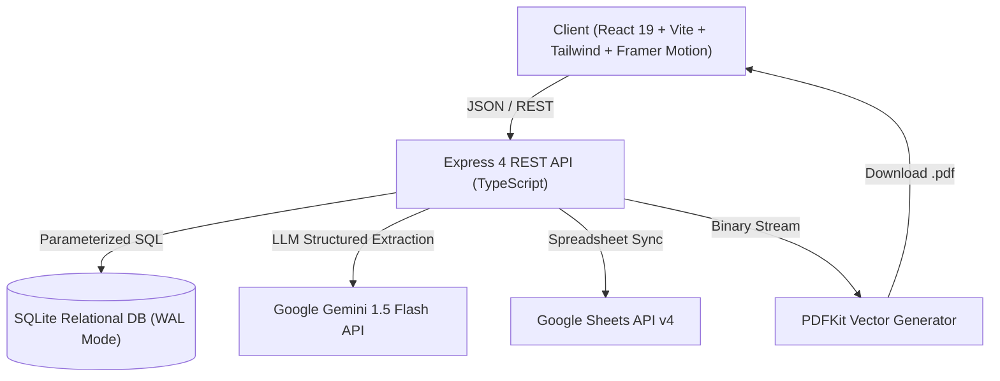

# PortfolioOS Architecture Documentation

## System Architecture Overview

PortfolioOS is architected as a modular, type-safe full-stack system designed for deterministic evidence grounding, AI-assisted career document generation, and bi-directional cloud integration.

---

## 1. Frontend Layer (`client/`)

- **UI Paradigm:** Apple visionOS and macOS-inspired liquid glass material system.
- **Visual Design System:**
  - Base backgrounds: `#08090B` (Main Canvas), `#101216` (Secondary Canvas).
  - High translucent surfaces with `backdrop-filter: blur(20px - 28px)`.
  - Inset highlights, subtle edge reflections, restrained ice-blue accents (`#38BDF8`).
  - High-contrast editorial typography (SF Pro / Inter and Serif Charter).
- **Core Modules:**
  - **Overview:** System diagnostic dashboard, portfolio metrics, quick actions.
  - **My Portfolio:** Relational CRUD interface for Profile, Education, Skills, Projects, Experiences, Certifications, and Achievements.
  - **Job Matcher:** Real-time job posting requirement extractor with evidence cross-referencing and confidence scoring.
  - **Resume Studio:** Split-screen WYSIWYG studio with live floating paper preview, drag/click section ordering, custom bullet points, and live vector PDF download.
  - **Google Sheets Integration:** Sheet connection status, sync logs, and manual push/pull operations.
  - **Settings:** Environment verification, seed demo data, and full JSON backup/restore.

---

## 2. Backend Layer (`server/`)

- **Runtime:** Node.js v24 LTS + Express 4 + TypeScript.
- **Service Layer Abstraction:**
  - `PortfolioService`: Encapsulates database transactions, CRUD operations, and JSON schema import/export.
  - `GeminiService`: Coordinates the official `@google/generative-ai` SDK with strict JSON response grounding, and manages an automatic deterministic keyword-matching fallback engine.
  - `ResumeService`: Handles resume metadata, version tracking, section ordering, and tailored presets.
  - `PdfService`: Vector document renderer using `PDFKit`, supporting multi-page headers, footers ("Page X of Y"), link annotations, and template switching.
  - `GoogleSheetsService`: Interacts with Google Sheets API v4 via `googleapis` JWT Service Account authentication, organizing data across dedicated worksheet tabs with column-A stable IDs.

---

## 3. Shared Library Layer (`shared/`)

- **Single Source of Truth:**
  - Zod schemas for runtime request validation and type safety.
  - Shared TypeScript interfaces for Portfolio, Job Analyses, Resumes, and Sync Logs.
  - Guarantees zero schema drift between frontend and backend.

---

## 4. Safety & Grounding Principles

1. **Non-Hallucination Directive:**
   The AI prompts and deterministic engines are strictly grounded against real records in the SQLite database. If a job description calls for skills or qualifications not evidenced in the portfolio, the status is marked `NOT_EVIDENCED` with empty evidence and clear rationale.
2. **Deterministic Fallback:**
   If `GEMINI_API_KEY` is not provided or the Gemini API is unreachable, the system automatically falls back to deterministic rule-based keyword extraction and portfolio matching, clearly labeled as `deterministic_fallback`.
3. **Idempotent Sheets Synchronization:**
   Every exported worksheet row is indexed by its database UUID in Column A, preventing duplicate appends during repeated sync runs.
