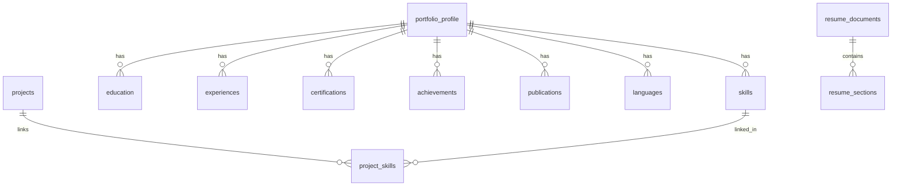

# PortfolioOS Database Schema

PortfolioOS uses an ACID-compliant SQLite relational database (`portfolio_os.db`) configured with Write-Ahead Logging (`WAL`) mode, foreign key cascade constraints, and indexed queries.

---

## Entity Relationship Overview

---

## Detailed Table Specifications

### 1. `portfolio_profile`
Main candidate bio, contact information, and core summaries.
- `id` (TEXT, PK): Unique identifier (UUID v4).
- `full_name` (TEXT, NOT NULL): Candidate full name.
- `headline` (TEXT, NOT NULL): Professional tagline or title.
- `email` (TEXT, NOT NULL): Verified email.
- `phone` (TEXT): Telephone contact.
- `location` (TEXT): City, State / Country.
- `website_url` (TEXT): Personal portfolio link.
- `github_url` (TEXT): GitHub profile URL.
- `linkedin_url` (TEXT): LinkedIn profile URL.
- `summary` (TEXT, NOT NULL): 2-4 sentence professional summary.
- `career_objective` (TEXT): Target career direction.
- `created_at` (TEXT): ISO 8601 creation timestamp.
- `updated_at` (TEXT): ISO 8601 update timestamp.

### 2. `skills`
Individual technical and soft skills with categorization and proficiency.
- `id` (TEXT, PK): UUID v4.
- `name` (TEXT, NOT NULL): Skill identifier (e.g., "TypeScript").
- `category` (TEXT, NOT NULL): 'Languages' | 'Frameworks & Libraries' | 'Databases & Cloud' | 'Tools & DevOps' | 'Core Concepts' | 'Soft Skills'.
- `proficiency` (TEXT, NOT NULL): 'Beginner' | 'Intermediate' | 'Advanced' | 'Expert'.
- `years_experience` (REAL): Numerical duration in years.
- `created_at`, `updated_at`: Timestamps.
- **Indexes:** `idx_skills_category`, `idx_skills_name`.

### 3. `projects`
Evidence-backed engineering projects and architectural case studies.
- `id` (TEXT, PK): UUID v4.
- `title` (TEXT, NOT NULL): Project name.
- `subtitle` (TEXT): Short descriptive tagline.
- `role` (TEXT): Role held on the project (e.g., "Lead Frontend Architect").
- `start_date`, `end_date` (TEXT): Duration range.
- `description` (TEXT, NOT NULL): Project narrative overview.
- `bullet_points` (TEXT, NOT NULL): JSON array of bullet strings with action verbs.
- `technologies` (TEXT, NOT NULL): JSON array of tech stack tags.
- `github_url` (TEXT): Repository URL.
- `live_url` (TEXT): Deployed application URL.
- `featured` (INTEGER): Boolean flag (0 or 1).
- **Index:** `idx_projects_featured`.

### 4. `project_skills`
Many-to-many junction table between projects and skills.
- `project_id` (TEXT, FK -> projects.id ON DELETE CASCADE).
- `skill_id` (TEXT, FK -> skills.id ON DELETE CASCADE).
- `created_at` (TEXT).
- **Primary Key:** `(project_id, skill_id)`.

### 5. `experiences`
Work experience, internships, and research assistantships.
- `id` (TEXT, PK): UUID v4.
- `company` (TEXT, NOT NULL): Employer organization.
- `role` (TEXT, NOT NULL): Job title.
- `location` (TEXT): Location or "Remote".
- `employment_type` (TEXT, NOT NULL): 'Full-time' | 'Part-time' | 'Internship' | 'Contract' | 'Freelance'.
- `start_date`, `end_date` (TEXT).
- `is_current` (INTEGER): Boolean (0 or 1).
- `description` (TEXT, NOT NULL): Scope and domain.
- `bullet_points` (TEXT, NOT NULL): JSON array of impact achievements.
- `technologies` (TEXT, NOT NULL): JSON array of used tools.

### 6. `education`
Degrees, institutions, honors, and coursework.
- `id` (TEXT, PK): UUID v4.
- `institution` (TEXT, NOT NULL): College or University.
- `degree` (TEXT, NOT NULL): Degree type (e.g., "Bachelor of Science").
- `field_of_study` (TEXT, NOT NULL): Major field.
- `start_date`, `end_date` (TEXT).
- `is_current` (INTEGER).
- `gpa` (TEXT): Grade point average.
- `honors` (TEXT): Academic awards.
- `location` (TEXT).
- `description` (TEXT): Coursework and thesis details.

### 7. `certifications`
Verified external certifications and courses.
- `id` (TEXT, PK): UUID v4.
- `title` (TEXT, NOT NULL): Certification name.
- `issuer` (TEXT, NOT NULL): Issuing body (e.g., "Meta / Coursera").
- `issue_date` (TEXT, NOT NULL).
- `expiration_date` (TEXT).
- `credential_id` (TEXT).
- `credential_url` (TEXT).

### 8. `achievements`
Hackathon wins, honors lists, and competitions.
- `id` (TEXT, PK): UUID v4.
- `title` (TEXT, NOT NULL).
- `issuer` (TEXT, NOT NULL).
- `date` (TEXT, NOT NULL).
- `description` (TEXT).
- `category` (TEXT).

### 9. `publications`
Peer-reviewed papers, symposium presentations, and technical writings.
- `id` (TEXT, PK): UUID v4.
- `title`, `publisher`, `publication_date`, `url`, `description`, `authors`.

### 10. `languages`
Spoken/written natural language proficiencies.
- `id` (TEXT, PK): UUID v4.
- `language` (TEXT, NOT NULL).
- `proficiency` (TEXT, NOT NULL): 'Native' | 'Fluent' | 'Professional' | 'Conversational'.

### 11. `job_analyses`
Persisted job analysis records from Gemini or deterministic engine.
- `id` (TEXT, PK): UUID v4.
- `title` (TEXT, NOT NULL): Target position name.
- `company` (TEXT): Hiring organization.
- `raw_job_description` (TEXT, NOT NULL): Raw input text.
- `analysis_result` (TEXT, NOT NULL): JSON payload of requirements, matches, citations, and scores.

### 12. `resume_documents`
Custom named resume documents and version records.
- `id` (TEXT, PK): UUID v4.
- `name` (TEXT, NOT NULL): Version name.
- `target_role` (TEXT, NOT NULL).
- `target_company` (TEXT).
- `template` (TEXT, NOT NULL): 'classic_ats' | 'modern_professional'.
- `typography` (TEXT, NOT NULL): JSON configuration of font, scale, spacing, accent color.
- `professional_summary` (TEXT, NOT NULL): Tailored summary paragraph.
- `section_order` (TEXT, NOT NULL): JSON array of ordered section keys.
- `selected_skills` (TEXT, NOT NULL): JSON array of skill UUIDs.

### 13. `resume_sections`
Individual section item toggles and customized bullet points for each resume version.
- `id` (TEXT, PK): UUID v4.
- `resume_id` (TEXT, FK -> resume_documents.id ON DELETE CASCADE).
- `section_type` (TEXT, NOT NULL).
- `item_id` (TEXT, NOT NULL): Foreign ID of project, experience, or education.
- `order_index` (INTEGER, NOT NULL DEFAULT 0).
- `is_included` (INTEGER, NOT NULL DEFAULT 1).
- `custom_title` (TEXT).
- `custom_bullets` (TEXT): JSON array of customized bullets.
- **Index:** `idx_resume_sections_resume`.

### 14. `sheets_sync_logs`
Audit log of Google Sheets synchronization events.
- `id` (TEXT, PK): UUID v4.
- `action` (TEXT, NOT NULL): 'export_all' | 'export_tab' | 'import_all' | 'import_tab'.
- `status` (TEXT, NOT NULL): 'SUCCESS' | 'FAILED' | 'WARNING'.
- `items_synced` (INTEGER, NOT NULL DEFAULT 0).
- `tab_name` (TEXT).
- `error_message` (TEXT).
- `spreadsheet_id` (TEXT, NOT NULL).
- `timestamp` (TEXT, NOT NULL).
- **Index:** `idx_sync_logs_timestamp`.

### 15. `app_settings`
Key-value pair store for system configuration.
- `key` (TEXT, PK).
- `value` (TEXT, NOT NULL).
- `updated_at` (TEXT).
